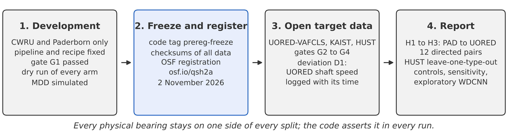
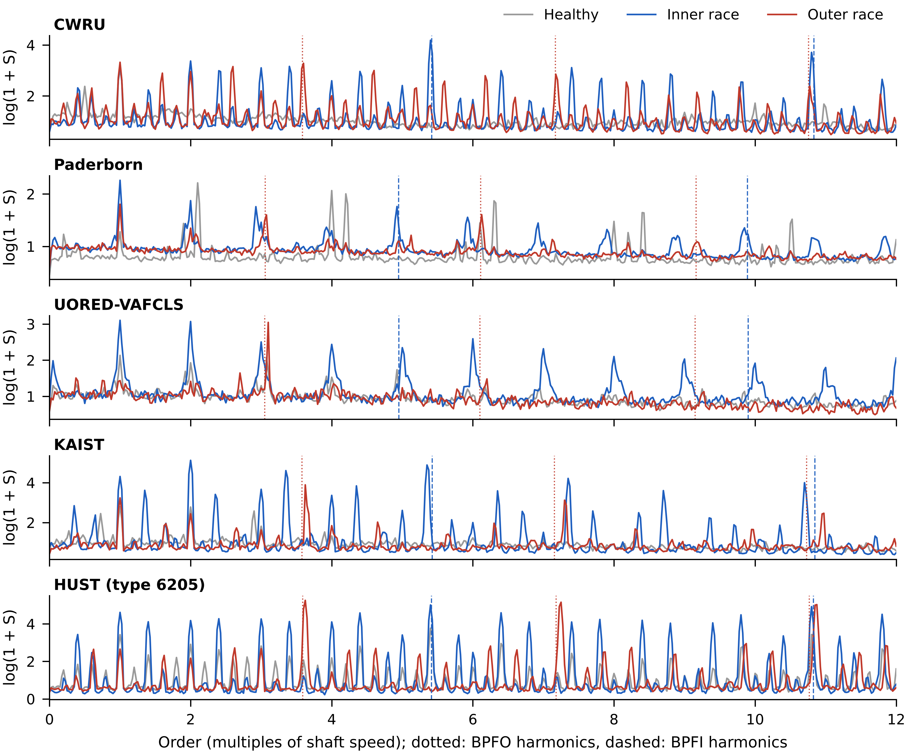
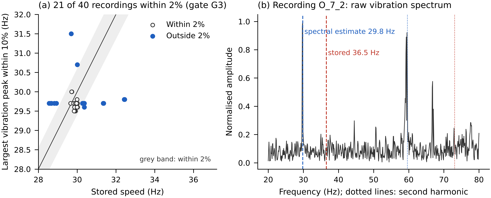
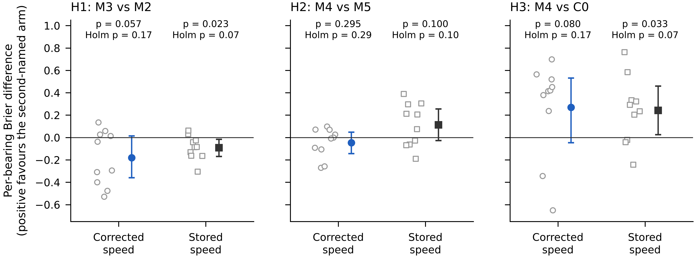
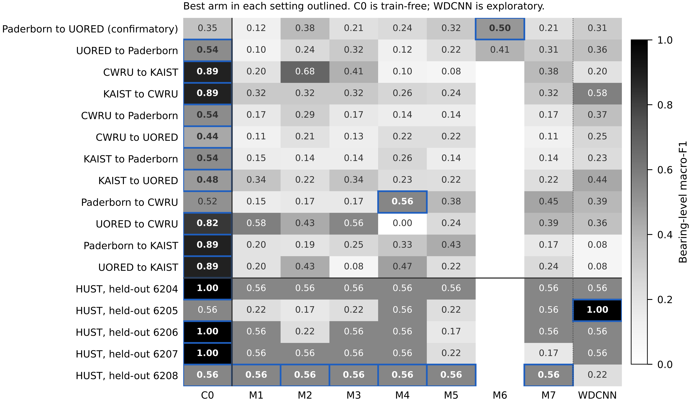
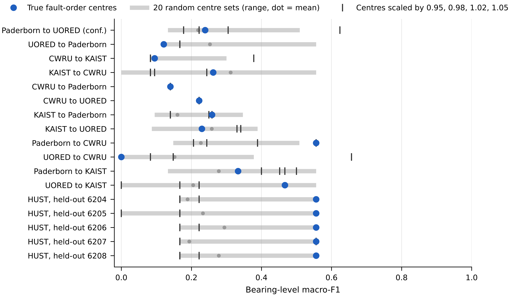
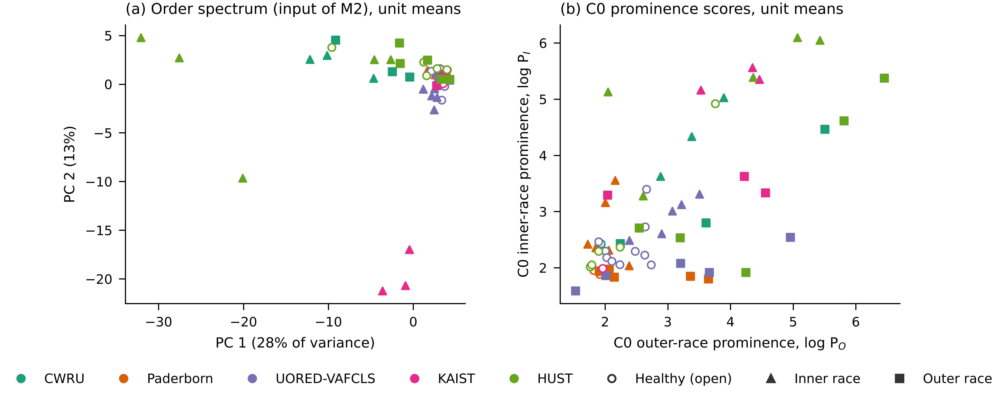

# Physics priors and cross-rig transfer in bearing fault diagnosis: a bearing-isolated benchmark against envelope analysis

Muawiya Sadiq^a,\*^

^a^ Department of Mechanical Engineering, Federal University of Technology Babura, \[postal address and P.M.B. to be added\], Babura, Jigawa State, Nigeria

\* Corresponding author. E-mail address: msadiq.mec@futb.edu.ng

## Abstract

Order-normalised spectra and weighting at bearing fault frequencies are often proposed to help deep networks diagnose bearing faults on a test rig they were not trained on, but much of the supporting evidence comes from splits sharing physical bearings between training and test and from comparisons without a classical baseline. We tested these priors with physical bearings kept apart and the confirmatory analysis registered before the target data were opened. One envelope-order pipeline fed a train-free envelope baseline and seven parameter-matched convolutional networks differing only in their input, including a geometry-normalised dual-axis spectrum, fixed Gaussian weighting at the target fault orders, a learnable-centre control and a published physics-weighted model. On the confirmatory pair, Paderborn to UORED-VAFCLS (same bearing size, different rig, 10 test bearings), no prior produced a detectable improvement in the per-bearing Brier score (Holm-adjusted p = 0.17, 0.29 and 0.17). In descriptive analyses of 17 settings on five datasets, the train-free baseline had the highest or tied-highest bearing-level macro-F1 in 14 (median 0.56, against 0.24 for the median network), and a standard raw-signal network did not change this. Fixed fault-order weighting often did as well with its centres shifted by 2%, one to seven kernel widths, as at the true orders. An exploratory model-free analysis locates the failure in rig shift: the healthy order spectrum moves between rigs by about 0.6 of the healthy-to-fault distance, the healthy envelope prominence by about 0.26. Every method struggles on unseen rigs; envelope analysis remains the baseline to beat.

## Keywords

Bearings; Envelope analysis; Order tracking; Fault diagnosis; Transfer; Benchmarking; Preregistration

## Highlights

- Physics priors were tested with no physical bearing shared by training and test
- No prior improved transfer from Paderborn to UORED-VAFCLS on 10 test bearings
- Train-free envelope analysis led or tied in 14 of 17 cross-rig settings
- Fault-order weighting often did as well with its centres shifted by 2%
- Between rigs, healthy spectra move by two-thirds of the fault effect

## 1. Introduction

Vibration-based diagnosis of rolling element bearings is one of the most studied problems in machine condition monitoring, and deep learning now dominates its literature \[1,2\]. A diagnosis method is useful in practice only if it works on a machine, and on bearings, that it has not seen during development. In that setting the method is given labelled vibration recordings from the bearings of one test rig, with their geometry and shaft speed, and must classify the bearings of another rig as healthy or as having an inner-race or outer-race fault, knowing only their geometry and speed. No recording of the new rig is available for training or tuning, and no physical bearing is shared between the two.

The classical answer to this problem is envelope analysis. Impacts at a localised defect excite structural resonances, and band-pass filtering around a resonance, demodulation and spectral analysis of the envelope reveal peaks at the fault characteristic frequencies \[3\]. Order tracking makes these peaks independent of speed \[4\], and spectral kurtosis can choose the band \[5\]. Because the method needs only the geometry and the speed, it transfers between machines by construction. Its weaknesses are the choice of band and detection threshold and faults whose impacts are weak or masked; the benchmark study of Smith and Randall showed that how clearly a fault can be diagnosed varies widely between records of the same dataset \[6\].

Data-driven deep models learn features from raw signals, spectra or time-frequency images and need no feature design \[1,2,7\]. Within one dataset they reach very high accuracy, but much of it comes from leakage: when windows of the same recording or bearing sit on both sides of the split, a model can recognise the specimen rather than the fault \[8,9\]. Under bearing-wise splits accuracy drops, and the number of distinct training bearings becomes a main limit on generalisation \[10\]. Domain adaptation addresses the change of rig directly by aligning source and target feature distributions during training \[11\], but it needs target recordings before deployment, and its hyperparameters are hard to choose without target labels. It answers a different question from the one studied here.

A third line of work puts the known fault physics into the learned model: order axes normalised by the fault orders, weights or kernels at the fault frequencies, or physics-based layers and losses \[12,13\]. Since the physics holds on every rig, such priors should help a model trained on one rig to work on another. The evidence for this comes from splits that are not bearing-isolated, often with heavily overlapping windows and few reported bearings, and without a learnable control or a classical baseline \[13\]. Whether the network uses the prior as intended has rarely been tested. Across all of these approaches, results are usually reported without per-bearing uncertainty and with the analysis chosen after the results were seen, although preregistration can separate a confirmatory test from a search \[14\] and the choice of metric and test matters when there are few independent test units \[15\].

Four gaps follow. First, no study has tested, with physical bearings kept apart, whether physics priors improve the transfer of learned diagnosis between rigs. Second, learned models are rarely compared with train-free envelope analysis on the same bearings and splits, so their gain over the classical method is unknown. Third, it has not been checked whether a network given fault-frequency priors would perform the same with wrong frequencies. Fourth, there is no explanation in signal terms of why learned envelope-order representations do or do not carry over between rigs.

This paper addresses these gaps with a controlled, preregistered comparison in which the input representation is the only variable. All learned models share one envelope-order pipeline, one network body, one training recipe and the same parameter count, and a per-model hyperparameter search checks that the conclusions do not depend on that recipe. A train-free baseline uses the same fault orders without learning. Physical bearings are kept on one side of every split, and the hypotheses, metric and test were registered before the target datasets were opened. Controls break the prior on purpose, with shifted and random fault-frequency centres and shuffled labels, and a decomposition of the spectra into rig and fault effects explains the results without any model.

The main contributions are as follows. First, we report a preregistered, bearing-isolated test of physics priors for cross-rig bearing diagnosis on five public datasets (CWRU, Paderborn, UORED-VAFCLS, KAIST and HUST), with 12 directed transfer pairs and a leave-one-bearing-type-out case study. Second, we compare seven parameter-matched networks that differ only in their input, including a geometry-normalised dual-axis spectrum, fixed weighting at the target bearing's fault orders, a learnable-centre control, a healthy-reference normalisation and a replication of a published physics-weighted model \[13\], with a train-free envelope baseline scored on the same bearings. Third, we show that the train-free baseline matches or beats every learned model in most settings, including a standard raw-signal network, that tuning each network on its source bearings does not close the gap, and that the fixed fault-frequency weighting does not depend on the exact fault orders. Fourth, in an exploratory analysis we decompose envelope-order spectra into rig and fault effects and show that, between rigs, the healthy spectrum moves by about 0.6 of the fault effect while the healthy level of the fault-order prominence moves by about a quarter. Finally, we release an evaluation protocol for small numbers of test bearings, with a strictly proper per-bearing score, exact permutation inference, quality gates and a public deviation record, together with code and checksums.

For practitioners, the results show that fault-order prominence in the envelope spectrum is the part of the diagnosis that carries over to a new machine, and that a model trained on a few bearings of another rig should not replace it without a direct comparison. For researchers, they provide a baseline, a protocol and a set of controls against which new cross-rig methods can be tested on the same bearings.

The paper is organised as follows. Section 2 describes the preregistered design and Section 3 the data. Section 4 presents the signal processing, the compared models and the statistical analysis. Section 5 reports the results, including the controls and the decomposition of the spectra, and Section 6 discusses them. Section 7 concludes.

## 2. Study design and preregistration

### 2.1. Sequence of the study

The study ran in three stages. In the development stage we built and tuned the pipeline on CWRU and Paderborn only, and ran a full dry run of every arm on the two development pairs (CWRU to Paderborn and back). The three target datasets (UORED-VAFCLS, KAIST and HUST) were downloaded and exported to one file by label-blind code, and the file was checksummed. Only the manifest, the array lengths and the UORED speed column were read before registration; reading the speed column was declared in the development log beforehand. In the second stage the protocol, code and checksums were frozen (commit 331fdff, tag prereg-freeze) and registered on OSF (osf.io/qsh2a). In the third stage the target data were opened, the gates were checked and every registered run was made. Changes made after opening are listed in Section 2.4 and in an update posted on the registration. Fig. 1 summarises the sequence.

{width=16cm}

Fig. 1. Sequence of the study. The protocol, code and data checksums were frozen and registered before the three target datasets were opened.

### 2.2. Questions and hypotheses

The study asks whether geometry-normalised envelope-order inputs and fault-frequency priors improve transfer between rigs under whole-bearing isolation, compared with parameter-matched learnable controls and a train-free envelope baseline. Three two-sided hypotheses were confirmatory, all on the Paderborn to UORED-VAFCLS pair (Table 1). Both datasets use bearings of the same size (6203; BPFO 3.054 and 3.050 orders, Table 4), so this pair changes the rig but hardly the geometry; pairs that also change the geometry are reported descriptively. The arm for H3 was fixed on theoretical grounds: M4 and C0 use the same knowledge of the fault orders, so H3 asks whether learning on top of that knowledge helps. In the dry run the two best learned arms differed by 0.003 in macro-F1, which is too small to select on.

Table 1. Registered research questions.

| ID | Comparison (Paderborn to UORED-VAFCLS) | Question | Type |
| --- | --- | --- | --- |
| H1 | M3 versus M2 | Does a geometry-normalised input help transfer? | Confirmatory |
| H2 | M4 versus M5 | Is a fixed physics prior better than learning the same freedom from data? | Confirmatory |
| H3 | M4 versus C0 | Does learning on top of the fault-order prior beat its train-free use? | Confirmatory |
| R1 | M7 minus M2 against the published gain | Does the published physics-weighted model replicate? | Replication, outside the Holm family |
| RQ4 | All arms on all pairs and the HUST case study | Why does transfer fail where it fails, and does any gain survive a geometry change? | Exploratory |

### 2.3. Quality gates

Four gates were registered (Table 2). G1 was passed during development, after the recipe changes recorded in the log. G2 to G4 were checked on the opened data.

Table 2. Registered quality gates.

| Gate | Check | Pass criterion | If it fails |
| --- | --- | --- | --- |
| G1 | The pipeline learns within each source dataset | Leave-bearings-out macro-F1 of at least 0.70 for M2 and M3 | Fix the pipeline on development data |
| G2 | The target can be diagnosed by envelope methods | C0 IR/OR detection AUROC of at least 0.65 and within-target ceiling of at least 0.60 | Report the target as below the gate; exclude it from pooled analysis |
| G3 | Isolation and integrity | No bearing in both training and test (asserted in code); checksums match; geometry recomputed; UORED shaft peak within 2% of the speed used | Stop and correct |
| G4 | Controls behave as expected | Label-shuffle M2 no more than 0.05 above the best constant prediction | Investigate before reporting |

### 2.4. Deviations from the registered protocol

Three changes were made after the target data were opened (Table 3). Each was triggered by a check, decided without reference to labels or results, and logged with its time.

Table 3. Deviations after opening the target data.

| No. | Change | Trigger | Effect on confirmatory analysis |
| --- | --- | --- | --- |
| D1 | UORED shaft speed estimated from the vibration spectrum instead of the stored value | Gate G3 failed (Section 5.1) | Results reported under both speeds (Section 5.7) |
| D2 | Empty inner cross-validation folds skipped; fixed 30 epochs if none is usable | Runtime error with few source bearings | None; made before any confirmatory learned-arm result |
| D3 | Each physical bearing assigned to one fold (UORED bearings have healthy and faulty states) | Same | None for Paderborn, CWRU, KAIST and HUST; made before any confirmatory learned-arm result |

Three analyses were added after the confirmatory analysis and are reported as exploratory; none enters a test. They are an arm based on WDCNN \[7\], a widely used raw-signal network; a per-arm hyperparameter search on the source bearings; and the model-free decomposition of the spectra in Section 5.5.

## 3. Data

### 3.1. Datasets

Five public datasets were used (Table 4). All contain healthy bearings and bearings with inner-race (IR) and outer-race (OR) faults; ball and cage faults were not used. Paderborn \[16\] contributes bearings with natural damage from accelerated life tests, together with healthy bearings, recorded at four operating conditions. UORED-VAFCLS (University of Ottawa Rolling-element Dataset: Vibration and Acoustic Faults under Constant Load and Speed) \[17\] contains 20 bearings recorded first healthy and then, for bearings 1 to 10, in developing and faulty states (inner race for bearings 1 to 5, outer race for 6 to 10). KAIST \[18\] has one seeded bearing per crack size (0.3, 1.0 and 3.0 mm) for each race, recorded at 0, 2 and 4 Nm, with the fault-seeded bearing in housing A. HUST \[19\] contains one bearing per class for each of five bearing types (6204 to 6208) on one rig at three loads. CWRU is the drive-end 12 kHz set.

Table 4. Datasets, geometry and bearing counts used in this study.

| Dataset | Bearing | BPFO / BPFI (orders) | Bearings used (healthy / IR / OR) | Role |
| --- | --- | --- | --- | --- |
| Paderborn | 6203 | 3.054 / 4.946 | 4 / 6 / 5 (plus 2 healthy in the reference pool) | Primary source; secondary target |
| UORED-VAFCLS | 6203ZZ and FAFNIR 203KD (same geometry) | 3.050 / 4.950 | Healthy states of bearings 1 to 10 / 5 / 5 (bearings 11 to 20 healthy, reference pool) | Confirmatory target; secondary source |
| CWRU drive end | SKF 6205-2RS | 3.585 / 5.415 | 1 / 3 / 3 | Secondary source and target |
| KAIST | NSK 6205 DDU | 3.577 / 5.423 | 1 / 3 / 3 | Secondary source and target |
| HUST | 6204 to 6208 | 3.09 to 3.62 / 4.91 to 5.43 by type | 5 / 5 / 5 (one per type and class) | Case study |

Fault orders were computed from the number of rolling elements, ball diameter and pitch diameter of each bearing, taken from the dataset documentation, with zero contact angle. They are stored in a geometry registry with the source of every row and were recomputed as part of gate G3.

### 3.2. Units and isolation

The physical bearing is the unit of isolation and inference. A bearing in one health state is a scored unit; a UORED bearing therefore gives two units (healthy and faulty), while a Paderborn or CWRU bearing gives one. For KAIST, the three loads of a seeded bearing are one bearing; the single healthy bearing is one unit. For HUST, the three loads of one bearing are pooled. Training and test sets never share a bearing identifier, and the code asserts this for every run.

Two healthy-reference pools were reserved before opening: Paderborn K005 and K006, and the healthy recordings of UORED bearings 11 to 20. They are used only to build the healthy reference for arm M6 and are never trained on or scored by any arm. The developing states of UORED bearings 1 to 10 are excluded from all registered analyses.

### 3.3. Shaft speed

CWRU and Paderborn speeds come from the recorded speed. HUST speed comes from the shaft-frequency field stored in each file. KAIST runs at a nominal 3010 rpm (50.17 Hz), refined by searching for the largest raw-spectrum peak within plus or minus 3% of nominal. For UORED the registered source was the value stored in each recording; Section 5.1 explains why it was replaced by the KAIST rule (deviation D1).

## 4. Methods

### 4.1. Signal processing

Every arm uses the same pipeline. Each recording is resampled to 12 kHz with a polyphase filter and cut into windows of 40 shaft revolutions. At most 40 windows are kept per scored unit, spread evenly through its recordings. Each window is band-pass filtered between 2.0 and 5.5 kHz (fourth-order Butterworth, zero phase). The squared Hilbert envelope is taken, its mean removed and a Hann window applied. The FFT amplitude is interpolated onto an order grid from 0 to 40 orders in steps of 0.025 (1,600 bins) and divided by its own median. Learned arms take the logarithm of one plus this spectrum.

The fault orders of a bearing with n rolling elements, ball diameter d, pitch diameter D and contact angle φ are

$$ \mathrm{BPFO} = \frac{n}{2}\left(1 - \frac{d}{D}\cos\varphi\right), \qquad \mathrm{BPFI} = \frac{n}{2}\left(1 + \frac{d}{D}\cos\varphi\right) \qquad (1) $$

in multiples of shaft speed. Every window carries the geometry of its own bearing, so arms that use fault orders use the correct values on mixed-geometry data such as HUST.

Fig. 2 shows the median envelope-order spectrum of healthy, inner-race and outer-race units on each dataset. Fault harmonics are visible on every rig, but the background level, the shaft harmonics and the relative height of the peaks differ from rig to rig.

{width=16cm}

Fig. 2. Median envelope-order spectrum, log(1 + S), of the units of each class on each dataset, 0 to 12 orders. Dotted lines: BPFO harmonics; dashed lines: BPFI harmonics. HUST is shown for bearing type 6205.

### 4.2. Arms

Table 5 lists the arms. C0 is train-free. M1 to M7 share one convolutional body (three convolution blocks with batch normalisation, max pooling, global average pooling, dropout 0.3 and a linear classifier) and differ only in input. The width of the first layer was set so that all learned arms stay within 1% of 10,211 trainable parameters.

Table 5. Arms compared.

| Arm | Input | Parameters |
| --- | --- | --- |
| C0 | Train-free: harmonic prominence of BPFO and BPFI | None (threshold and temperature fitted on source) |
| M1 | Envelope spectrum on a hertz axis, 0 to 1 kHz | 10,131 |
| M2 | Order spectrum, 0 to 25 orders | 10,131 |
| M3 | Dual-axis spectrum: two channels rescaled by BPFO and BPFI, 0 to 6 fault orders each | 10,311 |
| M4 | M2 with 8 Gaussian bumps at BPFO and BPFI harmonics 1 to 4; centres of each window's own bearing | 10,211 |
| M5 | M2 with 8 Gaussian bumps whose centres are learned | 10,211 |
| M6 | M3 divided by the median healthy-reference spectrum of the same dataset (Paderborn and UORED only) | 10,311 |
| M7 | Replication of Ma et al. \[13\]: BPFO-normalised axis 0 to 8, weights at outer orders 1 and 2 and inner orders r and 2r | 10,131 |
| WDCNN | Exploratory: 2,048 raw samples from the start of each window, z-scored \[7\] | 53,603 |

C0 scores each window by the prominence of the first three harmonics of BPFO and of BPFI. For each harmonic it takes the peak within plus or minus 2% of the expected order and divides it by the median of the spectrum within plus or minus 0.5 order, excluding the peak band. The scores P\_O and P\_I are summed over harmonics. A window is called IR or OR, whichever score is larger, if that score exceeds a threshold τ, and healthy otherwise. τ maximises macro-F1 on the source bearings.

M4 receives each window's centres as part of its input. In training these are the source bearing's fault orders; at test they are the target bearing's. The learned parameters are the amplitude and width of each bump; widths are bounded between 0.03 and 0.25 orders. M5 has the same layer with learnable centres, initialised at random between 1 and 16 orders, and learnable widths. In M7 the weight function is 1 plus 2 Gaussians at outer orders 1 and 2 and 1 Gaussian at inner orders r and 2r, where r is the BPFI to BPFO ratio; the width (0.15) was not reported by the original authors and was assumed.

### 4.3. Training and model selection

All learned arms use Adam (learning rate 0.001, weight decay 0.0001), batch size 64, class-weighted cross-entropy, amplitude jitter between 0.9 and 1.1 and additive Gaussian noise of 0.05. Augmentation never touches the centre values given to M4. The number of epochs is chosen by grouped cross-validation over source bearings (three folds, checkpoints at 5, 10, 15, 20, 25, 30, 40, 50 and 60 epochs). With CWRU as source this is not possible, because each fold would hold out one or two fault bearings, so CWRU sources use a fixed 30 epochs, a value set on development data. Each arm is trained with five seeds, and the seed models are averaged at prediction. No target window is used for training, epoch choice or preprocessing. As an exploratory check on this fixed recipe, each learned arm was also tuned on the Paderborn and UORED-VAFCLS pairs over 18 configurations (learning rate 0.0005, 0.001 or 0.002; weight decay 0.0001 or 0.001; dropout 0.1, 0.3 or 0.5). Each configuration was scored by the same grouped cross-validation over source bearings (three seeds), and the best configuration and epoch were retrained with five seeds and applied once to the target.

### 4.4. Bearing-level scores

For each scored unit the class probabilities are averaged over its windows and over the five seeds. The unit is assigned the class with the highest mean probability. Bearing-level macro-F1 is computed over units, so a bearing with many windows counts once.

The confirmatory metric is the multiclass Brier score \[20\] of the averaged forecast p for a unit with true class y:

$$ B = \sum_{k=1}^{3} \left(p_k - \mathbb{1}[y = k]\right)^2 \qquad (2) $$

It ranges from 0 to 2; a forecast of one third for each class scores 0.667. Each physical bearing scores the mean of its units. The Brier score is strictly proper, so it rewards a forecast that is honest about its uncertainty; the mean probability of the true class, which we considered first, is not \[20\].

C0 gives hard decisions. Scoring hard labels against probabilities on a proper score penalises the format rather than the diagnosis \[23\]. C0 therefore enters through a softmax of log(τ, P\_I, P\_O) divided by one temperature T. T minimises the Brier score of held-out source bearings in leave-one-bearing-out cross-validation on the source only. The largest entry reproduces every C0 decision, and the code asserts that no decision changes.

### 4.5. Statistical tests

For each confirmatory hypothesis we compute the paired difference in Brier score for each of the 10 UORED bearings, signed so that a positive value favours the second arm. The test statistic is the mean difference. Its exact two-sided p-value comes from all 2^10 = 1,024 sign assignments. Paired non-parametric tests over independent units are the usual recommendation for comparing classifiers \[21\]. Holm correction \[22\] runs across H1 to H3 at a familywise level of 0.05. Intervals come from inverting the sign-flip test and, as a check, from a bootstrap over physical bearings (10,000 resamples). Bearing-level macro-F1 is reported with intervals but not tested: with 10 bearings its power stays below 0.72 even for a true difference of 0.4.

Before registration we simulated the minimum detectable difference from the development data. Paired per-bearing Brier differences had a median standard deviation of 0.73, so 80% power needs a true difference of about 0.75 at α = 0.05 and 0.95 at the strictest Holm level. The tests can therefore detect only large effects, and the intervals carry most of the information. A non-significant result is reported as no detectable difference of the registered size, not as equivalence.

Three sensitivity analyses of H3 were registered: C0 entered as one-hot forecasts, per-bearing correctness with an exact sign test on discordant bearings, and the mean of window-level Brier scores.

## 5. Results

### 5.1. Gates

G3 failed on its first check. The UORED speed stored in each recording matched the accelerometer's shaft peak within 2% in only 21 of 40 recordings. The stored value was identical across all states of a bearing, and on bearings 7 and 8 it was 31.4 to 36.5 Hz, above the 30 Hz synchronous speed of the drive. The accelerometer showed a clear peak at 29.5 to 29.8 Hz in 36 of 40 recordings, with its second harmonic at 1.97 to 2.02 times that frequency. We read the stored value as a per-bearing setting rather than the speed during the recording (Fig. 3). As the registration requires, we stopped and corrected: UORED speed now uses the KAIST rule (deviation D1). On the scored bearings this gives 29.5 to 29.8 Hz. As an independent check that uses no labels, the envelope of the 2.0 to 5.5 kHz band, which the pipeline itself uses, shows a stronger shaft-rate peak at the corrected speed than at the stored one in 16 of the 18 recordings where the two differ by more than 2%. The other G3 checks passed: the checksum of the target file matched, all nine geometry rows recomputed to the registered values, and the isolation assertion held in every run.

{width=16cm}

Fig. 3. Gate G3 on UORED-VAFCLS. (a) Stored speed against the largest vibration peak within 10% of it, for all 40 recordings; points are jittered horizontally. (b) Raw vibration spectrum of recording O\_7\_2: the shaft peak and its second harmonic sit at the spectral estimate (29.8 Hz), not at the stored value (36.5 Hz).

Table 6 gives G2. C0 detected faults above the registered AUROC on every dataset (0.75 to 0.90). The within-target ceiling, the leave-bearings-out macro-F1 of M2 trained and tested on the same dataset, was below 0.60 for UORED (0.54) and HUST (0.52). Both are reported as below the gate and are not pooled with other targets. The confirmatory tests on UORED were still run, as registered, and should be read with this ceiling in mind. G4 passed: the label-shuffle M2 control scored 0.178 on the confirmatory pair, against 0.222 for always predicting healthy.

Table 6. Gate G2 on each dataset.

| Dataset | C0 AUROC, IR | C0 AUROC, OR | C0 AUROC, mean | Within-target ceiling | G2 |
| --- | --- | --- | --- | --- | --- |
| Paderborn | 1.000 | 0.800 | 0.900 | 0.634 (macro-F1) | Pass |
| CWRU | 0.833 | 0.667 | 0.750 | 0.833 (mean IR/OR recall) | Pass |
| KAIST | 1.000 | 0.583 | 0.792 | 0.833 (mean IR/OR recall) | Pass |
| UORED-VAFCLS | 0.893 | 0.600 | 0.747 | 0.540 (macro-F1) | Below ceiling |
| HUST | 0.920 | 0.760 | 0.840 | 0.519 (macro-F1) | Below ceiling |

CWRU and KAIST have one healthy bearing, which never leaves training in grouped cross-validation, so their ceiling is the mean recall of the IR and OR classes.

### 5.2. Confirmatory tests

None of the three hypotheses was supported (Table 7, Fig. 4). The geometry-normalised input M3 scored worse than the raw order spectrum M2, by 0.18 Brier units; the exact interval just includes zero, while the approximate bootstrap interval does not. Fixed physics weighting M4 and its learnable-centre control M5 did not differ detectably. M4 scored better than C0 by 0.27 Brier units, an advantage that did not reach significance.

Table 7. Confirmatory tests on Paderborn to UORED-VAFCLS (10 physical bearings). Lower Brier is better; a uniform forecast scores 0.667. The difference is the second arm minus the first, signed so that a positive value favours the second arm.

| Hypothesis | Arms | Mean Brier | Difference | 95% interval, sign-flip | 95% interval, bootstrap | p | Holm p |
| --- | --- | --- | --- | --- | --- | --- | --- |
| H1 | M2, M3 | 0.741, 0.923 | −0.181 | −0.360 to 0.014 | −0.323 to −0.044 | 0.057 | 0.170 |
| H2 | M5, M4 | 0.686, 0.733 | −0.047 | −0.145 to 0.048 | −0.129 to 0.027 | 0.295 | 0.295 |
| H3 | C0, M4 | 1.002, 0.733 | 0.270 | −0.046 to 0.531 | −0.005 to 0.491 | 0.080 | 0.170 |

{width=16cm}

Fig. 4. Per-bearing paired Brier differences on the confirmatory pair (10 bearings, open markers), with the mean and 95% sign-flip interval, under the corrected UORED speed (blue) and the registered stored speed (black).

The advantage of M4 over C0 in H3 comes mainly from C0's confident errors. With C0 entered as hard labels the difference grows to 0.471 (unadjusted p = 0.037), and with window-level Brier scores it is 0.299 (p = 0.061). On per-bearing correctness, the two arms disagree on one bearing only, which C0 classifies correctly and M4 does not (sign test p = 1.0). In absolute terms, both arms are poor on this pair: C0 reaches a bearing-level macro-F1 of 0.35 and M4 of 0.24, and every arm except M6 (0.582) scores worse than a uniform forecast on the Brier score.

The replication criterion R1 was not met. The published model M7 scored 0.169 below M2 in macro-F1 (0.21 against 0.38) on the confirmatory pair, against a published gain of 0.11 to 0.16.

### 5.3. All transfer pairs

Fig. 5 gives bearing-level macro-F1 for every arm on all 17 settings, the 12 directed transfer pairs and the five folds of the HUST case study. These comparisons are descriptive; a tie means the same bearing-level macro-F1. The train-free C0 had the highest or tied-highest score in 14 of them, and in 15 of 17 if WDCNN is set aside. Its median over settings was 0.56. The median learned arm reached 0.24, and the best learned arm in each setting had a median of 0.50. C0 was strongest with KAIST as target (0.89 from every source), on CWRU from KAIST and UORED (0.89 and 0.82), and on three of five HUST bearing types (1.00). The learned arms were exceeded by C0 in every pair that crosses a geometry change except Paderborn to CWRU, where M4 scored 0.56 against 0.52.

{width=16cm}

Fig. 5. Bearing-level macro-F1 of every arm on every setting. The best arm in each row is outlined. C0 is train-free; M1 to M7 are parameter-matched; WDCNN is exploratory. M6 applies only to the Paderborn and UORED-VAFCLS pairs, which have a healthy-reference pool. The values are also given in Supplementary Table S1.

Many learned arms predicted only one or two classes on the target. On CWRU and KAIST targets, which have one healthy bearing and six fault bearings, collapse onto a single fault class gives macro-F1 values near 0.1 to 0.3. On HUST each held-out type has three units, so macro-F1 moves in steps and 0.56 corresponds to two of three units correct.

### 5.4. Controls on the physics weighting

If M4 uses the fault orders it is given, moving its centres away from the true orders should hurt it. Fig. 6 shows that this happened only partly. Averaged over settings, M4 scored 0.34 with the true centres and 0.22 with random centre sets. But the true centres beat all four perturbations (centres scaled by 0.95, 0.98, 1.02 and 1.05) in only 6 of 17 settings, and beat the best of 20 random sets in only 1. On the confirmatory pair, centres shifted by +2% gave a macro-F1 of 0.62, against 0.24 at the true centres. The shift is not small compared with the weighting itself. In the five M4 models of the confirmatory pair the learned bump widths were 0.051 to 0.062 orders (0.051 to 0.055 interquartile over all 85 trained M4 models), while a 2% shift moves the eight centres by 0.061 orders at the first BPFO harmonic and up to 0.396 orders at the fourth BPFI harmonic, that is, by one to seven kernel widths. Real fault peaks are spread by a slip of about 1 to 2% between the ball pass frequency and its calculated value, which matters at the first harmonic; from the second harmonic onwards a 2% shift moves every bump clear of the true order. Whatever benefit M4 had, therefore, did not come from the true fault orders. This does not show that a network cannot use them, only that this weighting did not make it do so.

{width=16cm}

Fig. 6. Bearing-level macro-F1 of M4 with the true fault-order centres (blue), with the centres scaled by 0.95, 0.98, 1.02 and 1.05 (ticks), and with 20 random centre sets drawn between 1 and 16 orders (grey band: range; grey dot: mean). The same trained models are used for every centre set; only the test input changes.

### 5.5. Rig and fault effects in the inputs

To see why the learned arms transfer poorly, we measured how much the inputs change between rigs and between fault classes, without any model and over all 64 scored units. This analysis was added after the confirmatory analysis and is exploratory. For each unit we averaged its M2 input (the log order spectrum, 0 to 25 orders) and its two C0 prominence scores (log P\_O and log P\_I) over its windows.

In the M2 input, the dataset explained 20% of the variance between units and the fault class 10%. To compare rig and fault effects on one scale, we computed, for each feature space, the Euclidean distance between the healthy centroids of every pair of datasets and divided it by the mean distance between the healthy and faulty centroids within a dataset (averaged over the five datasets and the two fault classes). In the M2 input this ratio had a median of 0.62 over the ten pairs of datasets (range 0.55 to 0.77; 0.58 for Paderborn and UORED-VAFCLS). In the C0 prominence scores the median was 0.26 (range 0.05 to 0.48; 0.34 for Paderborn and UORED-VAFCLS). Healthy units sit close together on every rig in prominence space (Fig. 7b), so a threshold fitted on one rig still falls between healthy and faulty units on another. Prominence is not free of rig effects: faults raise it by different amounts on different rigs, and the dataset explained 30% of its variance against 25% for the class. What stays stable is the healthy level, and that is the part a threshold depends on.

{width=16cm}

Fig. 7. Rig and fault effects without any model, one point per scored unit (colour: dataset; open circles: healthy; triangles: inner race; squares: outer race). (a) First two principal components of the mean order spectrum, the input of M2. (b) Mean C0 prominence scores.

### 5.6. HUST case study

In the HUST case study the model trains on four bearing types and is tested on the fifth, on one rig. C0 classified all three units correctly for types 6204, 6206 and 6207 and two of three for 6205 and 6208. Learned arms mostly reached two of three. M4 and M7, the arms that use the fault orders of each type, matched C0 on 6205 and 6208, the two types where C0 itself got two of three, and fell below it on the other three. Because each fold has three units, these results show the pattern of errors rather than a measurable difference between arms.

### 5.7. Sensitivity analyses

With the registered stored UORED speed instead of the corrected one, none of the confirmatory hypotheses was rejected either (Table 8), although all three unadjusted p-values were at or below 0.10. Descriptive scores on UORED were higher with the stored speed for most arms; C0 reached 0.61 and M4 0.57 in macro-F1. We did not choose the speed rule by these scores: the corrected speed is supported by the accelerometer shaft peak and by the envelope check described in Section 5.1. The direction of every confirmatory difference was the same under both speeds except H2, where M4 scored better than M5 with the stored speed.

Table 8. Confirmatory tests with the registered stored UORED speed.

| Hypothesis | Mean Brier | Difference | 95% interval, sign-flip | p | Holm p |
| --- | --- | --- | --- | --- | --- |
| H1 (M2, M3) | 0.714, 0.805 | −0.091 | −0.170 to −0.017 | 0.023 | 0.070 |
| H2 (M5, M4) | 0.564, 0.451 | 0.113 | −0.027 to 0.255 | 0.100 | 0.100 |
| H3 (C0, M4) | 0.693, 0.451 | 0.242 | 0.026 to 0.459 | 0.033 | 0.070 |

The exploratory WDCNN arm, a raw-signal network with five times the parameters of the matched arms, scored below C0 in 16 of 17 settings. Its one win was HUST type 6205 (1.00 against 0.56). On the confirmatory pair it reached 0.31 in macro-F1.

Per-arm tuning on the source bearings (Table 9) raised cross-validated macro-F1 on the source to a median of 0.81 for Paderborn and 0.71 for UORED-VAFCLS, but the tuned arms reached a median of only 0.27 and 0.31 on the respective targets. Against the registered recipe, tuning changed target macro-F1 by a median of +0.01 (Paderborn to UORED-VAFCLS) and +0.04 (UORED-VAFCLS to Paderborn). On UORED-VAFCLS to Paderborn no tuned arm approached C0 (0.54; best tuned arm 0.41). On the confirmatory pair, tuned M2 (0.42) and tuned M6 (0.46) scored above C0 (0.35), as untuned M6 already did (0.50). Tuning made the networks fit their source better without making them transfer better.

Table 9. Exploratory per-arm tuning on the source. Bearing-level macro-F1: cross-validated on the source (CV) and on the target, for the registered recipe (default) and the tuned configuration. C0 needs no tuning: 0.35 on Paderborn to UORED-VAFCLS and 0.54 on UORED-VAFCLS to Paderborn.

| Arm | PAD to UORED: CV, tuned | PAD to UORED: target, default | PAD to UORED: target, tuned | UORED to PAD: CV, tuned | UORED to PAD: target, default | UORED to PAD: target, tuned |
| --- | --- | --- | --- | --- | --- | --- |
| M1 | 0.87 | 0.12 | 0.19 | 0.71 | 0.10 | 0.17 |
| M2 | 0.74 | 0.38 | 0.42 | 0.72 | 0.24 | 0.41 |
| M3 | 0.81 | 0.21 | 0.29 | 0.71 | 0.32 | 0.35 |
| M4 | 0.76 | 0.24 | 0.24 | 0.62 | 0.12 | 0.26 |
| M5 | 0.87 | 0.32 | 0.34 | 0.76 | 0.22 | 0.26 |
| M6 | 0.81 | 0.50 | 0.46 | 0.71 | 0.41 | 0.31 |
| M7 | 1.00 | 0.21 | 0.21 | 0.76 | 0.31 | 0.31 |
| WDCNN | 0.52 | 0.31 | 0.21 | 0.67 | 0.36 | 0.36 |

## 6. Discussion

### 6.1. Why the train-free baseline transfers

C0 needs two things from a new rig: the bearing geometry and the shaft speed. Given those, it looks for impacts at the fault orders and compares their height with the local background. Nothing in that procedure depends on the source rig except one threshold, and the threshold sets only how much prominence counts as a fault. The learned arms depend on the source rig in many more ways. With 15 Paderborn bearings or 7 CWRU bearings to learn from, a network can separate the training classes by features that happen to differ between those few bearings: the resonance band, the background shape, the level of shaft harmonics. These features are specific to the rig and the specimens, and they do not move with the fault orders when the rig changes. Section 5.5 puts a number on this: in the order spectrum the healthy units of one rig sit two-thirds of a fault effect away from those of another, against about a quarter in C0's prominence scores. Vieira et al. \[10\] found that the number of distinct training bearings limits generalisation within a dataset; our results suggest the same limit applies, more strongly, across rigs.

The within-target ceilings support this reading. Even when trained and tested on bearings from the same rig, M2 reached only 0.54 on UORED and 0.52 on HUST. A learned arm cannot be expected to transfer better than it learns at home, while C0 does not need to learn at home at all.

### 6.2. What the physics priors did and did not do

The geometry-normalised input (M3) was meant to make the fault signature appear in the same place on every rig. It did not help on the confirmatory pair and scored worse than the raw order spectrum. Normalising the axis removes the effect of geometry, but between two rigs with almost the same bearing (6203 on Paderborn and UORED) there is little geometry effect to remove; what changes is the rig, and the axis does not touch that.

The fixed fault-order weighting (M4) did not beat its learnable-centre control (M5), and the centre controls show why. If the weighting worked as intended, moving its centres away from the true fault orders should have made it worse. That happened on average, but in most settings some shifted or random centre set did as well as or better than the true centres. The network used the weighting layer as extra capacity rather than as a pointer to the fault orders. The same reading fits the failed replication of Ma et al. \[13\]: under bearing isolation, the published physics weighting scored below the plain order spectrum on the confirmatory pair.

These results do not show that physics cannot help learned models. They show that putting the fault orders into the input, in the two ways tested here, did not make small convolutional networks use them. C0 uses the fault orders explicitly and without learning, and that was enough to beat every learned arm in most settings.

### 6.3. Implications for evaluation

Three practical points follow. First, a cross-rig study should report a train-free envelope baseline scored on the same bearings and the same split. Without it, a learned model that reaches 0.5 macro-F1 can look successful when a method with no training reaches 0.9. Second, results should be reported per physical bearing, with the number of bearings, and with a score that respects uncertainty. Our test set had 10 bearings, and the intervals in Table 7 span about half a Brier unit. Third, quality gates and a deviation log make it possible to change a protocol in the open. The UORED speed problem would have been hidden in an unregistered study; here it was caught by a registered check, corrected by a registered rule and reported with both versions of the result.

### 6.4. Limitations

The confirmatory pair has 10 physical target bearings. With the registered test, only differences of about 0.75 Brier units could be detected with 80% power, so a null result here does not exclude moderate effects. The descriptive results across 17 settings are more informative than the tests, and they point the same way.

The UORED speed was corrected after the data were opened. The correction was triggered by a registered gate, chosen without labels and supported by an independent envelope check, but the descriptive scores on UORED were higher with the stored speed. Readers can compare both versions in Tables 7 and 8. The confirmatory conclusion does not depend on the choice.

UORED and HUST fell below the registered within-target ceiling. Results on these targets show what transfer achieves on hard data, but they cannot separate a transfer failure from a dataset in which IR and OR faults are hard to tell apart with this pipeline.

The learned arms are small networks with one registered recipe; per-arm tuning was checked on two pairs only. Larger models, other architectures, or domain adaptation with unlabelled target data may perform differently. The exploratory WDCNN arm, five times larger and working on raw signals, did not change the picture, but domain adaptation was not tested and answers a different question, because it uses target data during training.

The Paderborn geometry was taken from the example fact sheet of the dataset and applied to every bearing. CWRU and KAIST each have one healthy bearing, so healthy-class errors on these targets rest on one unit. The pipeline uses one fixed band (2.0 to 5.5 kHz) for every dataset; a band chosen per recording, for example by spectral kurtosis \[5\], could change both C0 and the learned arms.

## 7. Conclusion

We tested whether physics priors help convolutional networks diagnose bearing faults on a test rig they have never seen, with every physical bearing kept on one side of the split and the confirmatory analysis registered in advance. A geometry-normalised input, fixed weighting at the fault orders and a published physics-weighted model did not improve transfer from Paderborn to UORED-VAFCLS, and none of the three confirmatory hypotheses was supported. Across 17 settings on five datasets, a train-free envelope baseline that uses the same fault orders directly matched or beat every learned arm in 14, including a standard raw-signal network. The fixed weighting did not prefer the true fault orders over shifted ones. Under bearing isolation, envelope analysis is the baseline that learned cross-rig methods have to beat, and studies of such methods should report it on the same bearings. Future work should test whether priors that act on the training objective, or on more source bearings from more rigs, change this result.

## Data and code availability

All five datasets are public (Section 3). The registration, update and deviation record are at osf.io/qsh2a. Code, the geometry registry, the development log, run outputs and checksums of every data file are in the study repository (frozen at commit 331fdff, tag prereg-freeze; results at later commits). \[Repository URL to be added before submission.\]

## CRediT authorship contribution statement

Muawiya Sadiq: Conceptualization, Methodology, Software, Formal analysis, Investigation, Data curation, Writing (original draft), Writing (review and editing), Visualization.

## Declaration of competing interest

The author declares no known competing financial interests or personal relationships that could have appeared to influence the work reported in this paper.

## Funding

&#91;Author to confirm.\] This research did not receive any specific grant from funding agencies in the public, commercial or not-for-profit sectors.

## Declaration of generative AI use

&#91;To be completed by the author according to the journal's policy on the use of AI tools in preparing the manuscript and code.\]

## References

1. Y. Lei, B. Yang, X. Jiang, F. Jia, N. Li, A.K. Nandi, Applications of machine learning to machine fault diagnosis: a review and roadmap, Mech. Syst. Signal Process. 138 (2020) 106587.
2. Z. Zhao, T. Li, J. Wu, C. Sun, S. Wang, R. Yan, X. Chen, Deep learning algorithms for rotating machinery intelligent diagnosis: an open source benchmark study, ISA Trans. 107 (2020) 224–255.
3. R.B. Randall, J. Antoni, Rolling element bearing diagnostics: a tutorial, Mech. Syst. Signal Process. 25 (2) (2011) 485–520.
4. K.R. Fyfe, E.D.S. Munck, Analysis of computed order tracking, Mech. Syst. Signal Process. 11 (2) (1997) 187–205.
5. J. Antoni, The spectral kurtosis: a useful tool for characterising non-stationary signals, Mech. Syst. Signal Process. 20 (2) (2006) 282–307.
6. W.A. Smith, R.B. Randall, Rolling element bearing diagnostics using the Case Western Reserve University data: a benchmark study, Mech. Syst. Signal Process. 64–65 (2015) 100–131.
7. W. Zhang, G. Peng, C. Li, Y. Chen, Z. Zhang, A new deep learning model for fault diagnosis with good anti-noise and domain adaptation ability on raw vibration signals, Sensors 17 (2) (2017) 425.
8. S. Kapoor, A. Narayanan, Leakage and the reproducibility crisis in machine-learning-based science, Patterns 4 (9) (2023) 100804.
9. J. Hendriks, P. Dumond, D.A. Knox, Towards better benchmarking using the CWRU bearing fault dataset, Mech. Syst. Signal Process. 169 (2022) 108732.
10. J.P. Vieira, V.A. Bauler, R.K. Rosa, D. Silva, Towards a more realistic evaluation of machine learning models for bearing fault diagnosis, Mech. Syst. Signal Process. (2026), \[volume and article number to be added\]; preprint [arXiv:2509.22267](https://arxiv.org/abs/2509.22267).
11. Y. Ganin, E. Ustinova, H. Ajakan, P. Germain, H. Larochelle, F. Laviolette, M. Marchand, V. Lempitsky, Domain-adversarial training of neural networks, J. Mach. Learn. Res. 17 (59) (2016) 1–35.
12. S. Shen, H. Lu, M. Sadoughi, C. Hu, V. Nemani, A. Thelen, K. Webster, M. Darr, J. Sidon, S. Kenny, A physics-informed deep learning approach for bearing fault detection, Eng. Appl. Artif. Intell. 103 (2021) 104295.
13. Ma et al., Meas. Sci. Technol. 36 (1) 016106, [doi:10.1088/1361-6501/ad9f87](https://doi.org/10.1088/1361-6501/ad9f87). \[Full author list, title and year to be added from the paper.\]
14. B.A. Nosek, C.R. Ebersole, A.C. DeHaven, D.T. Mellor, The preregistration revolution, Proc. Natl. Acad. Sci. U.S.A. 115 (11) (2018) 2600–2606.
15. G. Varoquaux, Cross-validation failure: small sample sizes lead to large error bars, NeuroImage 180 (2018) 68–77.
16. C. Lessmeier, J.K. Kimotho, D. Zimmer, W. Sextro, Condition monitoring of bearing damage in electromechanical drive systems by using motor current signals of electric motors: a benchmark data set for data-driven classification, in: Proc. Eur. Conf. PHM Society, 2016.
17. M. Sehri, P. Dumond, M. Bouchard, University of Ottawa constant load and speed rolling-element bearing vibration and acoustic fault signature datasets, Data Brief 49 (2023) 109327.
18. W. Jung, S.-H. Kim, S.-H. Yun, J. Bae, Y.-H. Park, Vibration, acoustic, temperature, and motor current dataset of rotating machine under varying operating conditions for fault diagnosis, Data Brief 48 (2023) 109049.
19. N.D. Thuan, H.S. Hong, HUST bearing: a practical dataset for ball bearing fault diagnosis, BMC Res. Notes 16 (2023) 138.
20. T. Gneiting, A.E. Raftery, Strictly proper scoring rules, prediction, and estimation, J. Am. Stat. Assoc. 102 (477) (2007) 359–378.
21. J. Demšar, Statistical comparisons of classifiers over multiple data sets, J. Mach. Learn. Res. 7 (2006) 1–30.
22. S. Holm, A simple sequentially rejective multiple test procedure, Scand. J. Stat. 6 (2) (1979) 65–70.
23. M. Assel, D.D. Sjoberg, A.J. Vickers, The Brier score does not evaluate the clinical utility of diagnostic tests or prediction models, Diagn. Progn. Res. 1 (2017) 19.

## Appendix A. CWRU records used

Table A.1 lists the CWRU drive-end records at 12 kHz used in this study, as required for work on this dataset. Each unit is one physical bearing recorded at 0, 1, 2 and 3 hp. Smith and Randall \[6\] assessed how clearly each CWRU record can be diagnosed by envelope analysis; we did not select records on that basis, and all four loads of each unit were used.

Table A.1. CWRU records used (drive end, 12 kHz; outer-race faults at the centred, 6 o'clock position).

| Unit | Class | Fault diameter (in) | Records at 0, 1, 2, 3 hp |
| --- | --- | --- | --- |
| N | Healthy | none | 97, 98, 99, 100 |
| IR007 | Inner race | 0.007 | 105, 106, 107, 108 |
| IR014 | Inner race | 0.014 | 169, 170, 171, 172 |
| IR021 | Inner race | 0.021 | 209, 210, 211, 212 |
| OR007 | Outer race | 0.007 | 130, 131, 132, 133 |
| OR014 | Outer race | 0.014 | 197, 198, 199, 200 |
| OR021 | Outer race | 0.021 | 234, 235, 236, 237 |
